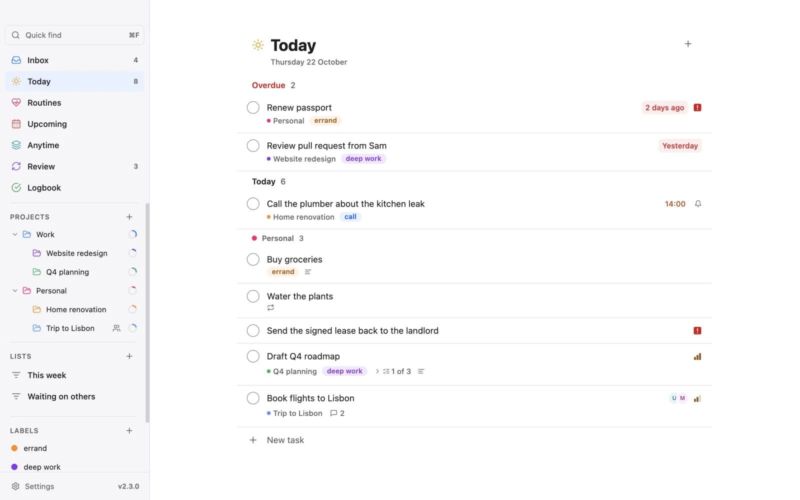
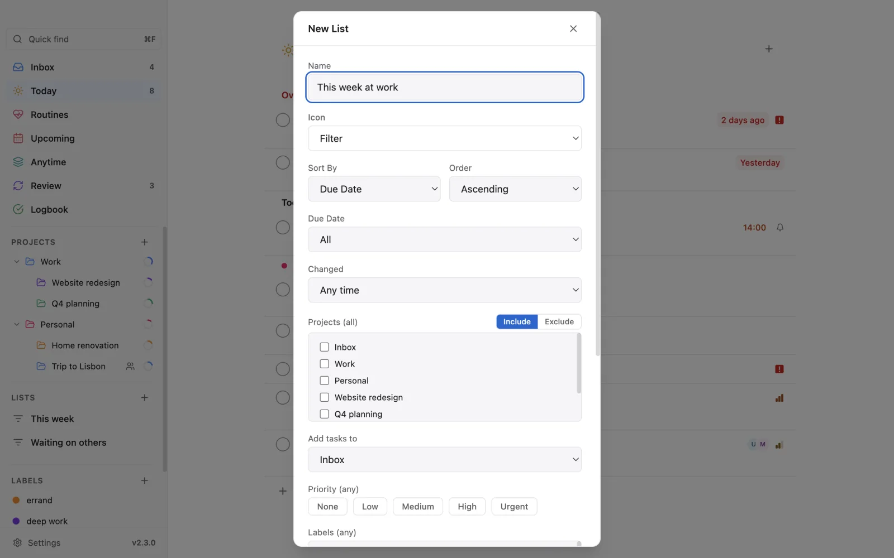

# Vicu

**From a thought to done, on every device.** Vicu is a calm, fast task manager for your own [Vikunja](https://vikunja.io/) server. Catch a task from any app in two seconds, plan your day in Today, and pick up on your phone where your desktop left off.

**[vicutodo.app](https://vicutodo.app/)** · [Download for desktop](https://github.com/rendyhd/Vicu/releases/latest) · [Vicu for Android and iOS](https://github.com/rendyhd/Vicu-Mobile)

[](https://vicutodo.app/)


[](https://ko-fi.com/rendyhd)

<picture>
  <source media="(prefers-color-scheme: dark)" srcset="site/assets/img/screens/desktop-today-dark.webp">
  
</picture>

## Get Vicu

| Platform | Get it |
|----------|--------|
| Windows 10 or 11 (x64) | [Installer (`.exe`)](https://github.com/rendyhd/Vicu/releases/latest) |
| macOS 13 or later (Apple Silicon) | [`.dmg`](https://github.com/rendyhd/Vicu/releases/latest), signed and notarized |
| Linux (x64, arm64) | [AppImage](https://github.com/rendyhd/Vicu/releases/latest) |
| iPhone and iPad (iOS 17 or later) | [TestFlight public beta](https://testflight.apple.com/join/c6wuvXrH) |
| Android 8 or later | [Google Play beta](https://github.com/rendyhd/Vicu-Mobile#download) or the [APK](https://github.com/rendyhd/Vicu-Mobile/releases/latest) |

You need a [Vikunja](https://vikunja.io/) **2.4.0 or newer** server you can reach: your own or [Vikunja Cloud](https://vikunja.cloud/). Vicu has no server or account of its own and collects nothing. Desktop builds check for updates every 12 hours.

## How it works

Organized around when, not where. No boards and no Gantt charts: a task lands in your **Inbox**, gets a day, and ends up in the **Logbook**. Projects and labels are there when you need them.

| List | What it shows |
|------|---------------|
| **Inbox** | Where new tasks land, from a hotkey, your voice, a widget or a share |
| **Today** | Due today, an Overdue section for what slipped, and today's routines |
| **Upcoming** | Everything from tomorrow on, grouped by day |
| **Anytime** | Your open backlog: every task outside the Inbox |
| **Logbook** | What you finished, grouped by the day you did it |

The days follow your own calendar and roll over at midnight. The desktop and mobile apps read your tasks by one shared set of rules ([`docs/cross-app-semantics-v1.md`](docs/cross-app-semantics-v1.md)) and share one design system, so a due date, a custom list or a task order means the same thing everywhere.

## Capture

- **Quick Entry** (`Alt+Shift+V`, `Cmd+Shift+Space` on macOS) floats over any app. Type, press Enter, and it is gone. Hold a modifier and press the arrow keys to switch project; add notes below the title.
- **Quick View** (`Alt+Shift+B`, `Cmd+Shift+B` on macOS) shows any list, smart or custom, to check off and edit without switching windows.
- **Hold + and say it.** Your words appear as you speak, with the date, project and labels picked out. Let go to add it. A voice shortcut works too: hold to talk, tap to keep listening (macOS and Windows).
- **Lands where you are**: added in a project it goes to that project, in Today it is due today.
- **Paste a list** (`Ctrl+V`) and every line becomes a task. `Ctrl+N` opens the composer.
- **Obsidian and browser links**: `Ctrl+L` in Quick Entry links the active Obsidian note (through the [Local REST API](https://github.com/coddingtonbear/obsidian-local-rest-api) and [Advanced URI](https://github.com/Vinzent03/obsidian-advanced-uri) plugins; the link survives renames) or browser tab (a bundled extension for Chrome, Edge, Brave, Vivaldi, Chromium and Firefox). Each has ask, always and off modes.
- **Works offline**: whatever you capture without a connection is sent once you are back.

Quick Entry and Quick View are off until you turn them on in **Settings, Quick Entry / View**, where you can also record your own hotkeys.

## Type it the way you think

Dates, times, projects, labels, priority, repeats and places are read as you type, highlighted, and shown as chips you can remove. Everything else is the title.

| Token | Examples |
|-------|----------|
| Days and dates | `tomorrow`, `friday`, `next Monday`, `in 3 days`, `jan 15`, `10/15` |
| Times | `3pm`, `at 14:00`, `in 2 hours` |
| Due today | `Buy milk !` |
| Projects, labels | `#work`, `#"side project"`, `@errand`, `@"grocery list"` |
| Priority | `p1`–`p4`, `!urgent`, `!high`, `!medium`, `!low` |
| Repeats | `every friday`, `every 3 days`, `daily` (as the last word) |
| Places | `when I get home`, `when I leave work` |

Prefer Vikunja's syntax? Switch to `*label` and `+project` in **Settings, General, Task Parser**. Desktop and mobile share one parser and one test corpus; the full rules are in [`shared-parser-spec.md`](shared-parser-spec.md).

## Organize

- **Areas and projects**: top-level areas with projects inside, progress rings and open counts. One project menu everywhere (sidebar, right-click, page header, Settings). Drag to nest or reorder, with Undo.
- **Sections** split a project into groups with their own headers and counts.
- **Custom lists**: your own views by project, label, due window (with or without overdue), priority, recent changes, assignee or unread comments. They sync, so the phone shows the same lists, and Quick View can show any of them.
- **Labels** with colours, always-readable chips and a page each. Drag a task onto one to apply it.
- **Routines**: habits next to your tasks, once or several times a day, with history and CSV export. Never overdue.
- **Project review**: step through your projects on a cadence to keep them current, one project at a time with its health ("7 open · 4 untouched for 30+ days · 1 overdue") and its next step.
- **Guided organizing**: sort the Inbox, overdue tasks or tasks that have waited for months one card at a time, with the keyboard, then Undo all if you change your mind. A weekly review checklist takes you through it in GTD order. With the assistant set up, each card comes with a suggestion you confirm ([how it works](docs/guided-organizing.md)).
- **Task order** per project: due date, priority, title, newest, oldest or manual. Subprojects follow their parent.
- **Find anything**: quick find as you type (`Ctrl+F`), Search through finished tasks too, and a command palette (`Ctrl+Shift+P`) for every list and action.

<picture>
  <source media="(prefers-color-scheme: dark)" srcset="site/assets/img/screens/desktop-list-editor-dark.webp">
  
</picture>

## Working with tasks

- **One When panel** for every date: type "next friday 9am", pick a quick choice, or move through the calendar with the keyboard.
- **A second to change your mind**: a finished task stays for five seconds, then collapses. One Undo covers a run of them.
- **Notes, checklists and subtasks**, rich text and links, pasted images and attachments.
- **Repeating tasks** on any interval; Undo puts the dates back.
- **Several at once**: select tasks to schedule, move, label, complete or delete them together.
- **Drag and drop** to reorder, move to a project or apply a label.

## Reminders and sharing

- **Reminders** at a set time or relative to a date, and a **default reminder** for every new dated task.
- **Location reminders**: "Call mom when I get home." Pick a place your phone saved and the phone reminds you when you arrive or leave. Where a place is never leaves the phone.
- **Daily summary** of what is overdue, due today and coming up, at the times you choose.
- **Share a project** with people on your server to view, edit or manage it. Sharing a project shares its subprojects.
- **Assign and comment**: see who is on a task, talk in a thread beside your list (`Ctrl+Shift+C`), mention people with `@`, and follow a task.
- **Lists for shared work**: Assigned to me, Waiting on others, Unread comments, Changed this week.

If you share nothing, none of this shows. With an API token sign-in, give the token the permissions for comments, assignees and sharing; Vicu tells you which one is missing.

## Sync and offline

- **Works offline**: create, edit, complete and comment; changes wait in a queue and go out in order when you are back. The app also starts offline with your last lists.
- **No overwrites**: Vicu sends only what you changed, so an edit on your computer never undoes one from your phone.
- **Settings that follow you**: your Inbox, task orders, custom lists, places and location reminders are the same on every device.
- **Nothing in between**: your data goes only to your Vikunja server. No account, no analytics, no ads.

**Hidden tasks.** Vikunja has no place for an app's own data, so Vicu keeps custom lists, routines and synced settings in tasks it marks done and hides everywhere. You may see them in other Vikunja apps (for example "Vicu preferences (sync metadata — do not delete)"); leave them in place.

## Look and feel

- Native on each system: Snap Layouts and Mica on Windows 11, traffic lights and a translucent sidebar on macOS, its own window controls on Linux. A tray icon, and a start at login if you want one.
- Light, dark or system, with every colour pair checked for readable contrast.
- Motion with a purpose: a task opens into its card and closes back into its row. With reduced motion, all of it becomes a plain fade.
- Accessible: one clear focus ring, real menus and dialogs, screen-reader announcements and Windows contrast themes. Priority shows without colour: one to three bars, and a square for urgent.

## Keyboard shortcuts

`Ctrl` is `Cmd` on macOS. Every shortcut can be changed in **Settings, Keyboard Shortcuts**.

| Shortcut | Action |
|----------|--------|
| `Alt+Shift+V` (`Cmd+Shift+Space`) | Quick Entry, from any app |
| `Alt+Shift+B` (`Cmd+Shift+B`) | Quick View, from any app |
| `Ctrl+N` / `Ctrl+V` | New task / new task from the clipboard |
| `Ctrl+F` / `Ctrl+Shift+P` | Quick find / command palette |
| `Up` / `Down`, `Enter` | Move between tasks, open one |
| `Space` | Complete the focused task and move to the next |
| `Ctrl+T` | Due today |
| `Alt+Shift+Up/Down` | Move a task up or down |
| `Ctrl+Shift+C` | Comments (shared projects) |
| `Ctrl+L` | Link the Obsidian note or browser tab (Quick Entry) |
| `F5` | Refresh from the server |

## Install and set up

- **Windows**: the build is not code-signed, so SmartScreen may ask you to confirm with **More info, Run anyway**.
- **macOS**: open the `.dmg` and drag **Vicu** into **Applications**.
- **Linux**: `chmod +x Vicu-*.AppImage`, then run it. On Wayland, accept the GlobalShortcuts consent dialog if one appears; if the hotkeys still fail, Settings shows commands to bind in your desktop's keyboard settings. On GNOME the tray needs the **AppIndicator and KStatusNotifierItem Support** extension. Obsidian detection and voice input are not available on Linux.

Then enter your server URL, sign in with a username and password (with two-factor), single sign-on (OpenID Connect) or an API token, and pick your Inbox project (if another device already chose one, Vicu suggests it). If your identity provider signs you in with a passkey (Pocket ID, for example), choose "Sign in through your browser": add `http://127.0.0.1:47823/vicu/oidc-callback` once as a redirect (callback) URL of the Vikunja client at the provider, since passkeys don't work in Vicu's own sign-in window on macOS and Linux. Turn on Quick Entry in Settings. `VICU_USER_DATA_DIR=<folder>` runs Vicu with a separate, throwaway profile.

## Building from source

Electron, React, TypeScript and Tailwind CSS. Node.js 22.12 or newer.

```bash
npm install
```

```bash
npm run dev
```

`npm test` runs the tests, `npm run verify` runs typecheck, tests and a build (before every commit), and `npm run dist` / `dist:mac` / `dist:linux` packages the app. The architecture and conventions are in [`CLAUDE.md`](CLAUDE.md), the rules shared with the mobile app in [`docs/cross-app-semantics-v1.md`](docs/cross-app-semantics-v1.md) and [`docs/design-system-v1.md`](docs/design-system-v1.md), release notes in [`docs/releases/`](docs/releases/), and the website in [`site/`](site/).

Found a bug or have an idea? [Open an issue](https://github.com/rendyhd/Vicu/issues).

## See also

- **[vicutodo.app](https://vicutodo.app/)**: the tour, with screenshots of desktop and mobile
- **[Vicu for Android and iOS](https://github.com/rendyhd/Vicu-Mobile)**: Vicu on your phone, iPhone and iPad
- **[vikunja-quick-entry](https://github.com/rendyhd/vikunja-quick-entry)**: a lightweight tray app with only Quick Entry and Quick View
- **[Vikunja](https://vikunja.io/)**: the open-source backend that powers Vicu

## Support Vicu

Vicu is free and open source, with no ads, no account and no paid tier. If it helps you, you can [support it on Ko-fi](https://ko-fi.com/rendyhd).

## License

[MIT](LICENSE)
